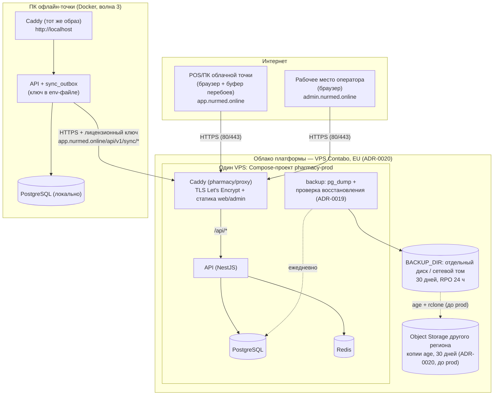

# C4 — Уровень: Размещение (Deployment)

Продукт разворачивается в собственном облачном окружении платформы. На пилоте — один VPS Contabo Cloud VPS 6 в регионе
EU (Германия) со всем Compose-проектом `pharmacy-prod`, домен `nurmed.online` (ADR-0020); условие ввода в эксплуатацию —
согласие юриста на хранение данных за пределами РТ. Разделение на VM приложений и VM БД — при росте нагрузки.

Способ запуска процессов: Docker Compose (ADR-0005).

## Серверные контейнеры (облако: один VPS, ADR-0020)

| Контейнер | Среда | Контур сети | Примечание |
|---|---|---|---|
| Reverse proxy / TLS-терминация — Caddy 2.11, образ `pharmacy/proxy` (ADR-0012) | VPS | Публичная зона: 80/tcp, 443/tcp, 443/udp — единственная точка входа | Let's Encrypt для `app.nurmed.online`, `admin.nurmed.online`, apex → `app.`; отдаёт статику web/admin из образа и проксирует `/api` на тот же origin (cookie сессии, ADR-0008); маршруты-экраны по `try_files {path} {path}.html {path}/index.html` без SPA-fallback; `/_next/static/*` — `immutable`, HTML, `*.txt` и `sw.js` — `no-cache`; на `admin.` — только `/api/v1/operator/*`, на `app.` — всё, кроме него. Том `/data` — ключи ACME и сертификаты |
| Клиентское веб-приложение (Next.js) | VPS, в образе proxy | Публичная (через proxy) | Статическая сборка `apps/web/out`, предсжатые br/gz |
| Админка оператора (Next.js) | VPS, в образе proxy | Публичная (через proxy) | Статическая сборка `apps/admin/out`; поддомен `admin.` |
| API (NestJS) | VPS | Приватная сеть compose (только за proxy, порт наружу не публикуется) | Stateless (сессии в Redis); `TRUST_PROXY=1` |
| PostgreSQL | VPS | Только сеть compose, снаружи недоступна | Ежедневная проверенная копия (ADR-0019) в `BACKUP_DIR`; вне хоста — шифрование `age` и выгрузка `rclone` в Object Storage другого региона, 30 дней (ADR-0020, до prod); RPO 24 ч / RTO 4 ч |
| Резервное копирование (`backup`, ADR-0019) | VPS | Только сеть compose | `pg_dump` ролью `pharmacy_backup` раз в сутки через общий локальный сокет, проверка каждой копии восстановлением во временный экземпляр, копии в `BACKUP_DIR` (отдельный диск или сетевой том); копия вне хоста (`age` + `rclone`, ADR-0020) — до prod; восстановление — `stack restore` |
| Redis | VPS | Только сеть compose | Потеря допустима (кэш/сессии) |

Среды: **prod** — на VPS; **test** (тестовая база заказчика — обязательна для приёмки, см. бэклог W2-05) — пока локально,
та же топология и тот же образ proxy с профилем `local` (`tls internal` на `*.localhost`), меньшие ресурсы.

## Офлайн-точка (распределённая установка на оборудовании тенанта)

Не серверный и не «store-distributed» тип — собственный канал поставки платформы:

| Параметр | Значение |
|---|---|
| Узел | Один ПК точки: 64-бит ОС с Docker (Windows 10/11 + WSL2, Linux), ≥ 8 ГБ ОЗУ |
| Состав | Docker-образы: proxy (Caddy, профиль `offline`, `http://localhost`, статика web) + API + PostgreSQL; автозапуск при загрузке ПК |
| Канал поставки | Установка оператором платформы: через интернет (снимки наборов `GET /api/v1/sync/snapshots/*`) или автономный флеш-комплект (образ + снимок облачных наборов на курсоре + партии с переносящими движениями, ADR-0014). С выпуска комплекта облако переводит точку в `offline-pending`: складская запись в облаке закрыта |
| Активация | Уникальный лицензионный ключ точки (выдаёт оператор; срок гибкий; отзыв — при следующей синхронизации); хранится в env-файле развёртывания точки |
| Конфигурация | Compose-профиль офлайн-точки: без Redis, `STORE_MODE=offline`, `SYNC_BASE_URL`, ключ и pepper точки в env-файле (ADR-0008, ADR-0014; профиль ещё не создан) |
| Обновление | Вручную оператором через удалённый доступ (TeamViewer/AnyDesk) при наличии интернета; облако поддерживает ≥ 2 предыдущие версии протокола синхронизации (преобразование операций на лету, ADR-0014) |
| Ответственность за данные | Несинхронизированные данные существуют только на ПК точки; ответственность тенанта (фиксируется в договоре); локальный бэкап — вне MVP |

## Клиентские устройства (без деплоя)

| Устройство | Что на нём | Примечание |
|---|---|---|
| POS-терминал / ПК облачной точки | Браузер (Chrome/Edge, последние 2 версии), сенсорный экран от 10″ | Буфер перебоев связи в браузере; сканер штрих-кода USB HID; принтер чеков 58/80 мм через печать браузера |
| ПК офлайн-точки | Браузер → localhost | Тот же ПК, где стоит Docker-дистрибутив |
| Рабочее место оператора | Браузер → админка | |

## Схема

Готовое изображение: img/deployment.png
