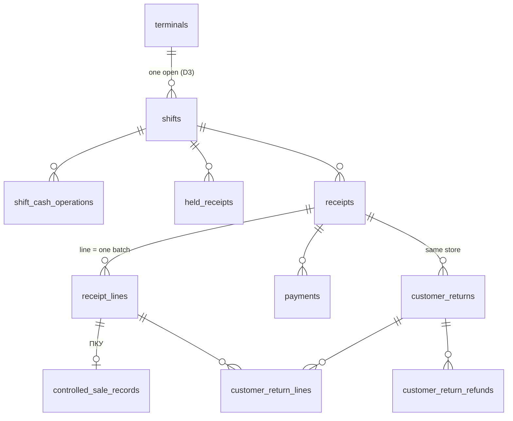

# 4. Касса

Соглашения — в [README](README.md). `tenant_id`, `(tenant_id, id)` и `created_at` в списках колонок не повторяются.

> **Введено миграцией `pos-shifts-sales` (2026-10-13, спецификация `docs/superpowers/specs/2026-10-13-pos-shift-sale-design.md`):** `shifts`,
> `shift_cash_operations`, `held_receipts`, `receipts`, `receipt_lines`, `payments`, `controlled_sale_records`
> (облачная точка; касса офлайн-точки — с синхронизацией). Возвраты покупателей (`customer_returns*`) —
> миграцией `customer-returns` (ниже), `payment_methods` — позже. Поправки модели (утверждены архитектором 2026-10-13, раздел 2.1 спецификации):
> - `id` смены, операции с наличными и чека — UUIDv7 операции клиента (ключ идемпотентности); отдельной колонки
>   `receipts.operation_id` нет; у смены, операций и чека есть `received_at` (приём сервером);
> - **смена на терминал** (D3), продажа и смена — только на привязанном терминале после входа по PIN;
>   номера `СМ-<код точки>-<год>-<6 цифр>` (счётчик `z_report`) и `ЧК-<код точки>-<год>-<6 цифр>` (`receipt`);
> - **закрытие смены — факт:** `discrepancy_reason` при расхождении может быть пустым — смена и Z-отчёт помечены
>   «причина не указана»; `terminal_totals` — суммы банковского терминала; `z_report` — снимок для повторной печати;
> - `shift_cash_operations`: причины `change_fund` / `other` (внесение), `collection` / `expense` (изъятие),
>   `comment`; у операций и смены — пометка автора (`author_flagged`, `opened_author_flagged`,
>   `closed_author_flagged`);
> - **продажа — факт** (ADR-0015): нехватка остатка, изменённая цена, скидка или карточка товара не отклоняют чек —
>   `receipts.discrepancy_kinds` (`stock`, `price`, `discount`, `catalog`, `author`, `closed_period`),
>   `receipt_lines.shortfall_pieces` и `current_price_dirams`; чек несёт значения снимка кассы
>   (`receipt_lines.pieces_per_pack`, `receipts.discount_min_total_dirams`);
> - **права автора** проверяются по текущему состоянию: неактивен, вне охвата или без права — пометка `author`, не
>   отказ (уточнение ADR-0015, 2026-10-13); онлайн-операция от имени не того сотрудника, что вошёл, — тоже `author`;
> - момент операции — часы ПК, исправленные на их разницу с сервером (заголовок `X-Client-Sent-At`), не старше 30 дней;
> - смена не удаляется, закрытая смена не меняется (триггер `shifts_guard`) — Z-отчёт печатается повторно как был;
> - `payments` — только `kind` (без `payment_method_id`); строка наличных хранит полученную сумму, Σ оплат = итог +
>   сдача; `receipts.cash_tendered_dirams`;
> - `receipts.origin` — `online` (принят в пределах 60 секунд от продажи) или `offline_buffer`; `fiscal_status` —
>   `not_required`, пока не выбрана фискализация;
> - `controlled_sale_records.prescription_note` — необязательные `prescriptionNumber`, `prescriptionDate`,
>   `clinic`, `doctor`, `buyerName`, `buyerDocument` (только заполненные); запись создаётся и без данных; очистка
>   по сроку — с журналом ПКУ;
> - `held_receipts.payload` — строки без данных ПКУ, `subtotal_dirams`; `label` не используется.

Синхронизация всего раздела: на офлайн-точке — точка → облако. Операции: `shift.opened`, `shift.cash-collected`, `shift.closed`, `receipt.completed` (чек + строки + оплаты + движения + записи ПКУ + аудит), `return.completed`. `held_receipts` — локально.

## `shifts` — смена кассы (класс `tenant`, D3)

| Колонка | Тип | Правило |
|---|---|---|
| `store_id`, `terminal_id` | uuid | |
| `number` | text | Номер Z-отчёта из `document_counters` (`z_report`) |
| `status` | text | `open` / `closed` |
| `opened_by`, `opened_at` | | |
| `opening_cash_dirams` | bigint ≥ 0 | |
| `closed_by`, `closed_at` | null | |
| `expected_cash_dirams` | bigint null | Начало + наличные продажи − наличные возвраты + внесения − изъятия, при закрытии |
| `counted_cash_dirams` | bigint null | Пересчёт |
| `discrepancy_dirams` | bigint null | `counted − expected` |
| `discrepancy_reason` | text null | Обязательна при расхождении ≠ 0 |
| `z_report` | jsonb null | Снимок Z-отчёта при закрытии: выручка по способам оплаты, возвраты, число чеков — повторная печать совпадает |

На один терминал — не больше одной смены `open` (уникальный частичный индекс `(tenant_id, terminal_id) where status = 'open'`).

## `shift_cash_operations` (класс `tenant`, только добавление)

`shift_id`, `kind` — `deposit` / `withdrawal`, `amount_dirams > 0`, `reason text`, `employee_id`, `occurred_at`.

## `held_receipts` — отложенный чек (класс `tenant`, локально)

`store_id`, `shift_id`, `held_by`, `held_at`, `payload jsonb` (строки, выбранные партии, скидка), `label text null`. Виден кассирам точки. Удаляется при оплате (становится `receipts`), отмене или закрытии смены (КП 5). Это единственная таблица кассы, где разрешён `DELETE`.

## `receipts` — оплаченный чек (класс `tenant`)

| Колонка | Тип | Правило |
|---|---|---|
| `store_id`, `terminal_id`, `shift_id` | uuid | Смена обязательна и открыта (БЛ 6.2) |
| `cashier_id` | uuid | Сотрудник PIN-сессии |
| `number` | text | Уникален в `(tenant_id, store_id, number)`; счётчик `receipt` |
| `local_number` | integer null 1…999999 | Номер чека терминала в смене (спецификация `2026-10-21-pos-offline-limits`, P12): касса присваивает его при «Оплатить»; не уникален — после очистки данных браузера касса продолжает счёт сервера. Чек без номера ЧК печатается с ним и кодом — последними 8 символами `id` (P13), по коду кассир находит чек для возврата (P14) |
| `sold_at` | timestamptz | |
| `business_date` | date | |
| `subtotal_dirams` | bigint | Сумма строк до скидки |
| `discount_rule_id` | uuid null | |
| `discount_percent_bp` | integer default 0 | |
| `discount_dirams` | bigint default 0 | |
| `total_dirams` | bigint | `subtotal − discount`; `check` |
| `change_dirams` | bigint default 0 | Сдача, только с наличной части |
| `status` | text | `paid` / `partially_returned` / `returned` |
| `operation_id` | uuid | Ключ идемпотентности (UUIDv7 клиента); уникален в `(tenant_id, operation_id)` |
| `correlation_id` | text | |
| `origin` | text | `online` / `offline_buffer` (буфер перебоев облачной точки) / `offline_store` |
| `fiscal_status` | text | `not_required` / `pending` / `sent` / `failed` |
| `fiscal_data` | jsonb null | Реквизиты ККМ — после выбора вендора (stack.md № 9) |
| `language` | text | Язык напечатанного чека |

Индексы: `(tenant_id, store_id, business_date)`, `(tenant_id, shift_id)`, `(tenant_id, created_at)` — чеки, записанные в облако после прошлого пересчёта витрин статистики (миграция `admin-stats`, спецификация `2026-10-19-admin-dashboard-stats-design.md`, D4). QR на чеке кодирует `id` чека — для поиска при возврате.

## `receipt_lines` (класс `tenant`)

Строка = **одна партия**. Если FEFO берёт товар из двух партий — две строки.

| Колонка | Тип | Правило |
|---|---|---|
| `receipt_id`, `line_no` | | |
| `product_id`, `batch_id` | uuid | Партия той же точки, не просрочена на момент продажи |
| `sale_unit` | text | `pack` / `piece` |
| `qty_pieces` | integer > 0 | |
| `unit_price_dirams` | bigint | Цена единицы продажи на момент продажи — чек не переоценивается |
| `line_amount_dirams` | bigint | |
| `discount_share_dirams` | bigint default 0 | Доля скидки чека (для возвратов и маржи) |
| `cost_dirams` | bigint | `qty_pieces × batches.cost_per_piece_dirams` — снимок для отчёта о марже |
| `batch_chosen_manually` | boolean | Кассир выбрал не FEFO (право `pos:choose-batch`) |

## `payments` (класс `tenant`)

`receipt_id`, `payment_method_id`, `kind` (снимок вида способа), `amount_dirams > 0`. Сумма оплат = `total + change`. Сдача только при наличной части: `check` на уровне чека проверяет приложение.

## `customer_returns`, `customer_return_lines`, `customer_return_refunds` (класс `tenant`)

> **Введено миграцией `customer-returns` (2026-10-13, спецификация `docs/superpowers/specs/2026-10-13-customer-returns-design.md`):** три таблицы
> возврата (только добавление), `tenant_settings.customer_return_otc / _rx / _controlled`, область `return` ключей
> идемпотентности; облачная точка. Поправки модели (утверждены архитектором 2026-10-13, раздел 2.1 спецификации):
> - `customer_returns.reason` `customer` / `defect` (не `null`) вместо `reason_code`; `id` — UUIDv7 операции клиента
>   (ключ идемпотентности), отдельного `operation_id` нет; `refund_dirams` (к возврату) вместо `total_dirams`;
>   номер `ВЗ-<код точки>-<год>-<6 цифр>` (счётчик `customer_return`); возврат — в открытую смену терминала
>   сессии, продажа могла быть в другой смене и другой день; возврат — факт: не правится и не отменяется;
> - `customer_return_lines`: `amount_dirams` (по цене, без скидки) и `discount_share_dirams` (доля этого
>   возврата); одна строка чека — не больше одной строки возврата; строка возвращается в единице продажи;
> - `customer_return_refunds.kind` (`cash` / `card` / `qr` / `nfc`) вместо `payment_method_id`, один вид — одна
>   строка; по виду — не больше оплаченного (наличные — за вычетом сдачи) минус прежние возвраты;
> - возвраты одного чека — под транзакционной advisory-блокировкой по `id` чека (строки чека только для
>   добавления, `FOR UPDATE` на них нет);
> - **политика возвратов сети** (R3): по виду товара (без рецепта / рецептурные / ПКУ) — принимать ли возврат
>   «по желанию покупателя»; брак принимается всегда; по умолчанию — без рецепта да, остальные нет;
> - **брак** (R2) списывается в той же операции, как истёкшая партия: одно проведённое списание СП на возврат,
>   причины `customer_return_defect` / `customer_return_expired`, только для чтения;
> - **сумма строки** (E6) — накопительно: доля скидки, снятая всеми возвратами строки, =
>   ⌈`discount_share_dirams` × возвращено / продано⌉, так что строка, возвращённая по частям, отдаёт ровно свою долю.

**`customer_returns`:**
- `id` — UUIDv7 операции клиента, он же ключ идемпотентности (отдельного `operation_id` нет);
- `store_id`, `shift_id` (открытая смена терминала сессии; продажа могла быть в другой смене и другой день), `terminal_id`, `cashier_id`; смена — смена этой точки: `(tenant_id, store_id, shift_id)` → `shifts (tenant_id, store_id, id)` (cr-M9);
- `receipt_id` — обязателен; ссылка `(tenant_id, store_id, receipt_id) → receipts (tenant_id, store_id, id)`, поэтому возврат на другой точке невозможен;
- `number` (`ВЗ-<код точки>-<год>-<6 цифр>`, счётчик `customer_return`), `returned_at`, `business_date`;
- `reason` — `customer` (по желанию покупателя) / `defect` (брак);
- `found_without_receipt boolean` — продажа найдена по товару и дате (право `returns:without-receipt`);
- `discount_returned_dirams` (доля скидки по возвращаемым строкам), `refund_dirams` (к возврату), `correlation_id`.

Возврат — факт: не правится и не отменяется.

**`customer_return_lines`:** `receipt_id` (чек возврата) и `receipt_line_id` — составные ключи: строка чека принадлежит чеку возврата (`(tenant_id, receipt_id, receipt_line_id)` → `receipt_lines (tenant_id, receipt_id, id)`), а чек — тому же возврату (`(tenant_id, customer_return_id, receipt_id)` → `customer_returns (tenant_id, id, receipt_id)`). Решение архитектора 2026-10-16 (cr-M9), миграции `audit-entity-index-return-keys` и `return-keys-validate`; `receipt_id` старых строк заполнен разово в миграции. `qty_pieces > 0` — штуки (целое число единиц продажи строки чека), `amount_dirams` (по цене, без скидки), `discount_share_dirams` (доля скидки этого возврата, ≤ `amount_dirams`); в одном возврате строка чека — не больше одного раза (по частям её возвращают несколько возвратов). Сумма возвратов по строке ≤ проданному: проверка под транзакционной advisory-блокировкой по чеку (строки чека только для добавления, `FOR UPDATE` на них нет).

**`customer_return_refunds`:** `kind` (`cash` / `card` / `qr` / `nfc`), `amount_dirams > 0`; один вид — одна строка. По виду — не больше оплаченного этим видом (наличные — за вычетом сдачи) минус прежние возвраты (КП 7).

**Правила:**
- возврат возможен в течение `tenant_settings.return_period_days` от `business_date` чека;
- товар возвращается движением `customer_return` в партию строки чека;
- **брак и товар, у партии которого на момент возврата истёк срок** (решения 2026-10-01 и R2), в той же транзакции списываются: создаётся и проводится одно списание `СП` на возврат с причиной `customer_return_defect` или `customer_return_expired`, ссылка `documents.source_customer_return_id` → возврат, только для чтения. На офлайн-точке оно входит в операцию `return.completed` (уточнить в ADR-0014);
- **скидка не пересчитывается по порогам** (решение 2026-09-30): к возврату — сумма возвращаемого количества минус снятая доля `receipt_lines.discount_share_dirams`. Доля считается накопительно: все возвраты строки снимают ⌈`discount_share_dirams` × возвращено / продано⌉ (E6), поэтому дробные дирамы уходят в пользу аптеки, а строка, возвращённая по частям, отдаёт ровно свою долю. Скидка на оставшуюся часть чека сохраняется.

## `controlled_sale_records` — продажа ПКУ и рецепт (класс `tenant`)

Строка создаётся на каждую строку чека с товаром `is_controlled`, даже если рецепт не приложен.

| Колонка | Тип | Правило |
|---|---|---|
| `receipt_line_id` | uuid | Уникален |
| `prescription_file_id` | uuid null | Фото или скан рецепта. **Пока необязателен** (решение 2026-09-30). Где и как хранится файл — будущий ADR о хранении файлов; до него колонка всегда пустая |
| `prescription_note` | jsonb null | Необязательные данные рецепта (номер, дата); поля не фиксируются |
| `recorded_by`, `recorded_at` | | |
| `prescription_purged_at` | timestamptz null | Данные рецепта удалены по сроку хранения |

**Срок хранения данных рецепта** — `tenant_settings.prescription_retention_days`, по умолчанию 90, меняется владельцем сети. Задача облака раз в час (спецификация `2026-10-21-pos-offline-limits`, P3; ADR-0013, поправка 2026-10-21) по тенанту удаляет файл и обнуляет `prescription_file_id` / `prescription_note` у записей старше срока, ставит `prescription_purged_at`. Таблица «только добавление» с одним исключением: триггер разрешает `UPDATE` лишь этих трёх колонок и только в сторону очистки. Строка о продаже ПКУ остаётся.

Миграция `pos-offline-limits`: триггер `controlled_sale_records_purge_only` пропускает `UPDATE`, только если очищаются `prescription_note` и `prescription_file_id`, ставится `prescription_purged_at` (один раз), а остальные колонки не меняются; `controlled_sale_records_no_delete` запрещает удаление; `pharmacy_app` получает `UPDATE` только на эти три колонки. Записи старше срока выбираются по частичному индексу `(tenant_id, recorded_at) where prescription_purged_at is null`, до 5000 за проход; в той же транзакции журнал получает событие `controlled.prescriptions-purged` с числом записей (`{ records }`).

**Журнал ПКУ** — отдельной таблицы нет. Это выборка: движения по товарам `is_controlled` за период по дням плюс записи продаж ПКУ. Журнал всегда сходится с движениями партий (БЛ W3-07) и не удаляется — удаляются только данные рецептов. Данные рецепта не пишутся в логи и аудит (ADR-0014 §8). В отчёте «Журнал ПКУ» у продажи два времени: «Продано» (`receipts.sold_at`) и «Получено» (`receipts.received_at`) — у чеков из буфера кассы и офлайн-точек видна задержка (спецификация `2026-10-21-pos-offline-limits`, P1); из записи отчёт читает только поля рецепта, данные покупателя не выводятся.
